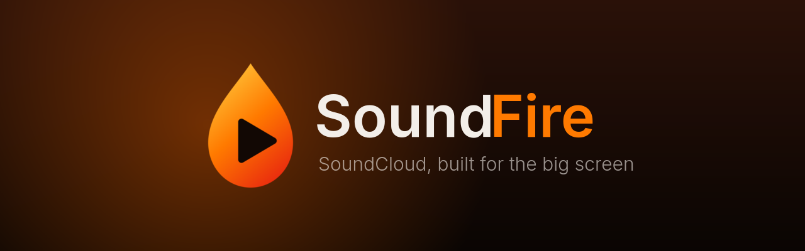
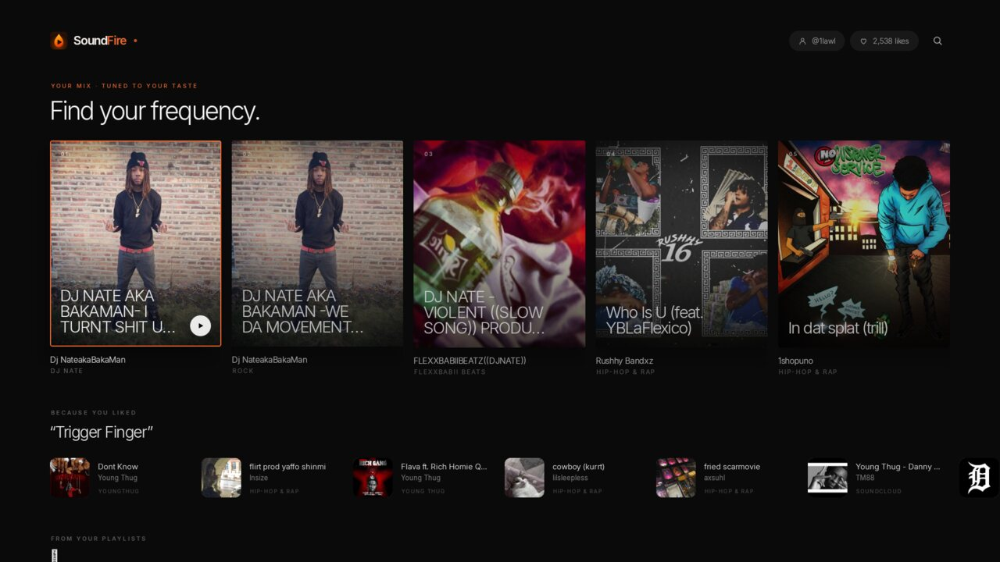
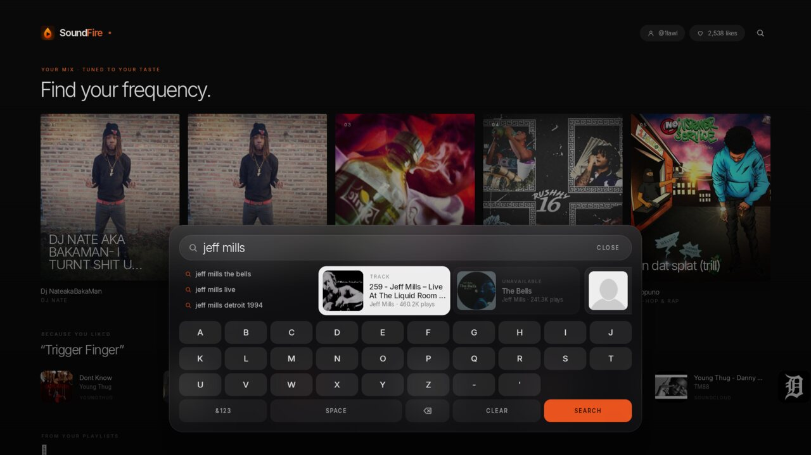
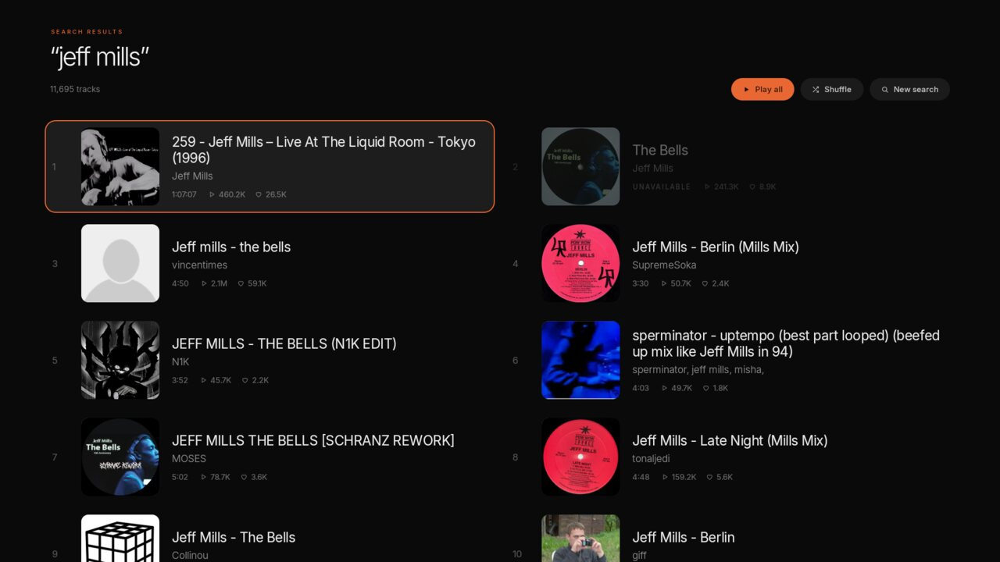

<p align="center">
  
</p>

<p align="center">
  A fast, native SoundCloud player for Amazon Fire TV.<br>
  Search, play and discover music from the couch, no account required.
</p>

<p align="center">
  
  
  
  
</p>

---

<p align="center">
  
  
  
  
</p>

## Features

- **Made for the remote.** Every screen is built for D-pad navigation, with a floating, translucent on-screen keyboard. Bluetooth keyboards work too.
- **Search everything.** Instant suggestions while you type, then a full results page that keeps loading as you scroll.
- **Your library, no login.** Enter a SoundCloud username to import its public likes and playlists. They stay in sync every time the app opens.
- **Recommendations that learn.** Your mix, *Because you liked…*, *From your playlists* and *More from…* rows are built on the TV from your likes, playlists and listening, and get better the more you play.
- **Endless playback.** When the queue runs out, related tracks keep playing.
- **Big-screen Playing Now.** Full-resolution cover art, a minimal transport bar, and an ambient mode that fades the UI away.
- **Remote friendly.** The play/pause, rewind and fast-forward keys work on every screen.
- **Small and quick.** A ~3 MB native app that starts in under a second on a Fire TV stick.

## Install

SoundFire is sideloaded. It isn't in the Amazon Appstore.

**With Downloader (easiest)**

1. On the Fire TV, enable *Settings → My Fire TV → Developer options → Install unknown apps* for **Downloader**.
2. Open Downloader and enter:
   ```
   https://github.com/1lawl/soundfire/releases/latest/download/soundfire.apk
   ```
3. Install, then open **SoundFire** from *Your Apps & Channels*.

**With ADB**

```sh
adb connect <fire-tv-ip>:5555
adb install -r soundfire.apk
```

APKs are published on the [Releases](https://github.com/1lawl/soundfire/releases) page.

## Using SoundFire

| Remote | Action |
| --- | --- |
| D-pad / OK | Move and select |
| Back | Close the keyboard or go back |
| ☰ Menu | Jump to Playing Now |
| ⏯ / ⏪ / ⏩ | Play-pause, back 10 s, forward 10 s |

To personalise the home screen, choose **Import your likes** in the header and enter a SoundCloud username, for example `1lawl` for `soundcloud.com/1lawl`. Only public data is read, and no password is ever needed.

## Build from source

Requirements: JDK 17 or newer and the Android SDK (platform 37).

```sh
git clone https://github.com/1lawl/soundfire.git
cd soundfire
./gradlew assembleRelease          # app/build/outputs/apk/release/app-release.apk
./gradlew installRelease           # or build and install to a connected device
```

Release builds are signed with the debug key so they can be sideloaded straight away. Use your own keystore for anything you distribute.

## How it works

| Layer | |
| --- | --- |
| UI | Jetpack Compose. Layouts are authored at 1920×1080 and scale uniformly to any TV resolution and aspect ratio, inside the TV-safe area. |
| Playback | Media3 ExoPlayer streaming SoundCloud's AAC HLS. Stream URLs are resolved just in time and refreshed if they expire mid-track. |
| Data | SoundCloud's public web API, the same one soundcloud.com uses when you're signed out. |
| Recommendations | An on-device taste profile (Room) weights likes, playlists, plays and skips, then ranks SoundCloud's related tracks, stations and artist catalogues against it. |

## Privacy

SoundFire has no accounts, analytics or ads. Your listening history and taste profile never leave the TV. The only network traffic is to SoundCloud, to fetch music.

## Disclaimer

SoundFire is an independent project. It is not affiliated with, endorsed by or sponsored by SoundCloud. It only plays streams SoundCloud makes publicly available: tracks that need SoundCloud Go+ or are protected with DRM are shown as unavailable, never bypassed. Support the artists you listen to.

## Acknowledgements

- Inspired by [sound-on-fire](https://github.com/timoknapp/sound-on-fire) by Timo Knapp (MIT).
- [Inter](https://rsms.me/inter/) typeface by Rasmus Andersson, SIL Open Font License (see [`licenses/`](licenses/)).

## License

[MIT](LICENSE) © 2026 1lawl
